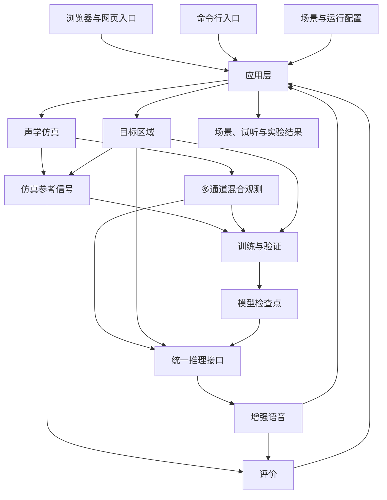

# ZonePick 技术架构

本文记录架构草案。MVP 的功能范围、接口细节和验收条件由正式 PRD 确认。

## 总体结构

采用 Python `src` 布局的模块化单体。各模块通过 Python 接口协作，可在同一代码库内开发、测试与部署。批量推理、训练和网页服务可以按运行场景启动独立进程，共用核心模块。

| 规划路径 | 职责与边界 |
| --- | --- |
| `src/zonepick/audio/` | 音频读写、STFT、ISTFT 和基础数字信号处理。处理采样率和张量约定。 |
| `src/zonepick/simulation/` | 根据房间、声源和阵列参数生成 RIR、通道混合及仿真参考信号。 |
| `src/zonepick/regions/` | 定义固定与自定义区域，处理坐标、成员判定和声源位置映射。 |
| `src/zonepick/algorithms/classical/` | 实现 DAS、MVDR 等阵列处理方法，使用观测与声明的空间条件。 |
| `src/zonepick/algorithms/hybrid/` | 实现 NN Mask + MVDR 等组合方法，网络估计掩码，阵列处理生成输出。 |
| `src/zonepick/algorithms/neural/` | 定义区域条件模型与推理实现，直接预测目标语音。 |
| `src/zonepick/training/` | 管理数据集、批次构造、损失、训练与验证、检查点保存及恢复。通过模型接口训练混合或纯神经网络组件。 |
| `src/zonepick/evaluation/` | 依据统一的信号对齐和指标协议计算 SIR、SI-SDR 等指标，汇总同一实验条件下的对照结果。 |
| `src/zonepick/application/` | 校验任务配置、选择算法、组织仿真与推理，并按任务请求调用评价和保存产物。 |
| `src/zonepick/web/` | 接收网页请求，转换为应用任务并展示场景、音频、波形、频谱和指标。 |
| `configs/` | 保存可共享的场景、算法、训练和评价配置。 |
| `tests/` | 覆盖音频维度与对齐、区域边界、指标计算及小型端到端流程。 |
| `scripts/` | 归档命令行入口及批量运行脚本，通过应用层和训练入口组织任务。 |
| `examples/` | 保存可分发的小型输入、样例配置与运行说明。 |
| `.github/workflows/` | 规划文档、静态检查及 CPU 小样例测试的 CI。 |

核心模块独立于网页和命令行。算法共享音频处理和区域接口，训练依赖模型定义，应用层负责组装具体实现。

## 数据流

仿真根据场景配置生成多通道混合观测，并保留各声源在指定通道上的独立贡献。区域模块按同一坐标约定判定声源归属，仿真按评价协议生成目标与干扰参考。应用层将混合观测、阵列几何和区域描述交给算法，按需将输出与参考送入评价模块。网页和 CLI 提交相同结构的任务配置，读取同一结构的结果。

## 算法接口草案

| 项目 | 约定 |
| --- | --- |
| 混合观测 | 单个场景的浮点波形 `[M, T]`，分别表示麦克风和采样点。显式传递采样率、通道顺序和参考麦克风索引。 |
| 空间条件 | 提供阵列坐标、目标区域和坐标约定，建议以米为单位。算法声明所需的额外推理条件及来源，如方向估计。 |
| 算法配置 | 实例化时解析参数和所需模型检查点。算法在入口校验输入形状、采样率与必需条件。 |
| 增强结果 | 候选约定为单通道 `[T]`，附采样率和对齐信息，供试听与评价。可附加掩码等诊断信息。多个区内说话人的输出语义由 PRD 确认。 |

DAS、MVDR 通过阵列几何和可用空间条件产生增强语音。混合算法在内部从观测估计掩码，再进行波束形成。纯神经网络算法根据观测与区域条件直接预测语音。各算法内部自行完成 STFT、特征转换和重建，对外共享波形接口。

## 训练、推理与评价

- **训练与验证**使用观测、区域条件和相应监督目标，管理数据划分、损失、优化及检查点。训练数据和评价数据按统一协议划分。
- **常规推理**使用混合观测及实际可获得的空间条件，混合和纯神经网络方法按需加载检查点。干净语音、真实逐源信号及仿真真值通过独立的参考数据路径提供给训练和评价。
- **仿真参考信号**记录目标与干扰的通道、混响口径、增益和对齐方式。目标是干声还是参考麦克风处的混响目标，需要在评价协议中确定。
- **Oracle 上界**通过独立实验使用理想掩码、真实方向或其他仿真真值。结果按所用额外信息和假设标注为特定方法的参考上界，单独列出。
- **算法比较**固定场景、混合输入、数据划分和指标口径。报告 SIR 时明确干扰分量的可获得性和估计协议，报告 SI-SDR 时记录参考与对齐规则，并约定静音场景的处理方式。

## 开发与实验复现

本地 WSL2 用于模块开发、CPU 测试、小样例仿真和轻量 GPU 调试。学校 GPU 服务器用于较大规模训练与批量实验。以 Git 提交和已解析配置同步代码和运行条件，按数据许可管理服务器上的数据与模型。先用小样例核对数据、指标和检查点恢复，再启动长任务。

每次运行分配标识，保存代码提交、完整解析配置、数据版本及划分、场景参数、各相关随机种子、运行环境和设备信息。训练另记损失、优化器、步数与检查点，推理记录模型版本及检查点标识或校验和。评价结果关联运行标识、指标定义、参考信号和对齐设置，并保留日志及必要音频。大型数据、检查点和生成结果分别放在外部存储或仓库根目录的 `data/`、`checkpoints/` 和 `runs/`。

## 参考设计

SEtrain 的 `plus` 分支将 Dataset、模型、损失、训练入口分开，训练与推理各有配置，评价又有独立入口和指标工具。ZonePick 借鉴这些职责划分来组织训练与离线实验，同时将区域条件、阵列仿真、三类算法和网页接入放入共享应用流程。借鉴范围限于架构设计，各模块独立实现，依赖版本按 ZonePick 自身需求验证。 [SEtrain plus 分支](https://github.com/Xiaobin-Rong/SEtrain/tree/plus)

## MVP 待确认

候选方案是用一个区内说话人和至少一个区外干扰者完成仿真，使用 DAS 与未增强输入比较，在浏览器展示场景、试听并查看指标。正式 PRD 需确定区域形状与边界、多区内说话人及空区域的输出语义、仿真工具与语料、基线和评价协议、验收门槛。网页框架、实验存储和模型设计随需求讨论。
